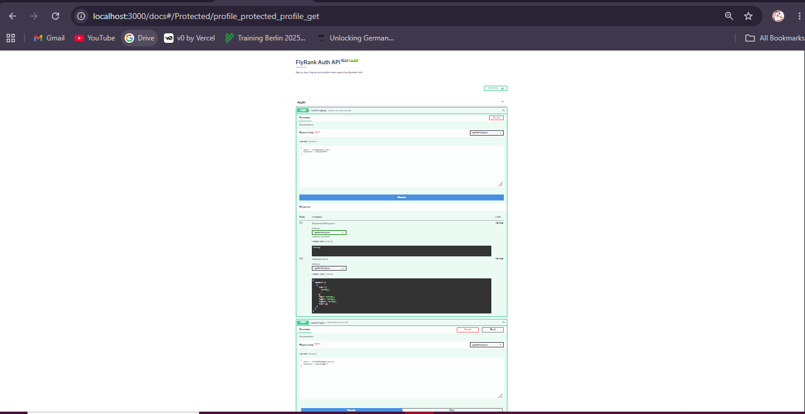

# FlyRank Auth API — Login & Protect (BE-03)

A secure REST API built with **Python + FastAPI** that uses **Supabase Auth** as the Identity Provider.
Users sign up and log in, receive a JWT, and present it as a Bearer token to reach protected routes.
A small **Node.js** script (`test/smoke.mjs`) runs the assignment checkpoints against the running server.

> **Database:** none needed. Supabase Auth stores users and passwords for us, so no SQLite/SQL database is used.

## Setup

Requirements: Python 3.10+, Node.js 18+ (only for the test script), a free Supabase project.

1. In Supabase: **Project Settings → API** → copy the *Project URL* and *anon key*.
2. For easy testing: **Authentication → Providers → Email** → turn off **Confirm email**.
3. Configure environment variables:
   ```bash
   cp .env.example .env      # then edit .env with your values
   ```
   ```
   SUPABASE_URL=your_project_url
   SUPABASE_KEY=your_anon_key
   PORT=3000
   ```
4. Install dependencies:
   ```bash
   python -m venv venv
   source venv/bin/activate        # Windows: venv\Scripts\activate
   pip install -r requirements.txt
   ```

## Run

```bash
python -m app.main
```
You should see `Server running and connected to Supabase`. Swagger UI: http://localhost:3000/docs

## API reference

| Method | Path | Auth? | Success | Errors |
|---|---|---|---|---|
| POST | `/auth/signup` | No | 201 + user | 400 missing/invalid input |
| POST | `/auth/login` | No | 200 + access & refresh token | 400 missing input, 401 bad credentials |
| POST | `/auth/logout` | Bearer | 204 | 401 |
| GET | `/public/info` | No | 200 | — |
| GET | `/protected/profile` | Bearer | 200 (id, email, created_at) | 401 |
| GET | `/protected/dashboard` | Bearer | 200 | 401 |

401 bodies: `{"error":"Access token required"}` (missing/malformed header) or `{"error":"Invalid or expired token"}`.

## Try it with curl

```bash
curl -i -X POST http://localhost:3000/auth/signup -H "Content-Type: application/json" \
  -d '{"email":"you@gmail.com","password":"password123"}'
curl -i -X POST http://localhost:3000/auth/login -H "Content-Type: application/json" \
  -d '{"email":"you@gmail.com","password":"password123"}'
curl -i http://localhost:3000/protected/profile -H "Authorization: Bearer <access_token>"
```

## Node.js smoke tests

With the server running, in a second terminal:
```bash
TEST_EMAIL=you@gmail.com TEST_PASSWORD=password123 npm test
```
(Windows PowerShell: `$env:TEST_EMAIL="..."; $env:TEST_PASSWORD="..."; npm test`)

## How it works

- `app/deps.py` — `require_user` dependency: reads the `Authorization: Bearer` header, verifies the token with `supabase.auth.get_user(token)`, returns the user or a 401. Used by every protected route (and `/auth/logout`).
- `app/main.py` — routes and error handlers (all errors are `{"error": "..."}`).
- `app/client.py` — Supabase client factory (a fresh client per request so sessions never leak between users).
- Logout calls Supabase's `/auth/v1/logout` with the caller's token, because supabase-py's `sign_out()` has no token argument.

## Swagger UI



*(Run the server, open `/docs`, click Authorize, paste your token, and save a screenshot as `docs/swagger.png`.)*

## Security notes

- `.env` is in `.gitignore` — never commit your keys.
- Only the public **anon** key is used; never put the service-role key in this project.
